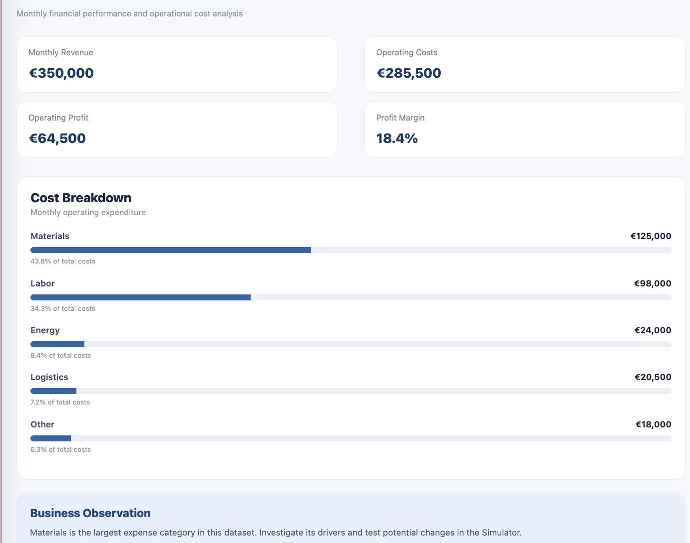
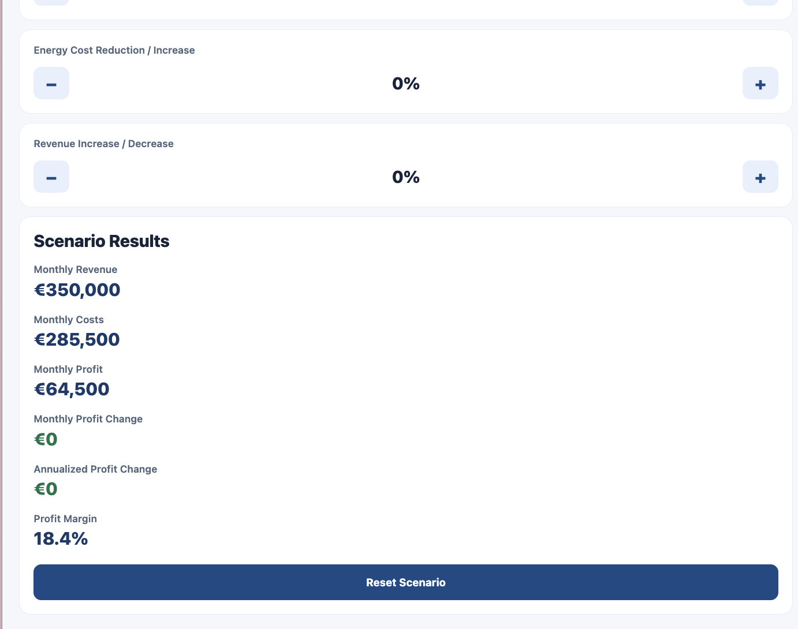
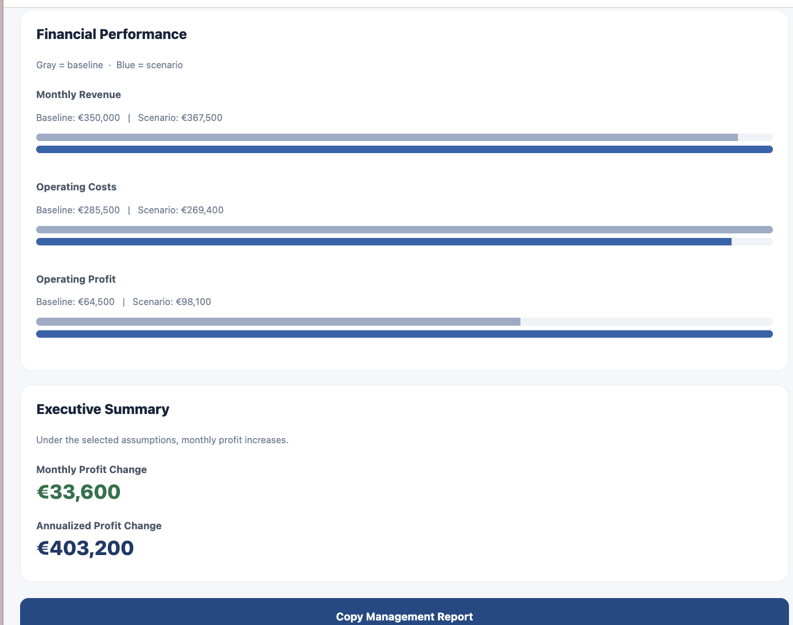

# OptiCore Analytics

**Business intelligence, scenario simulation and management reporting — portfolio MVP**

[Try the live web app](https://rayanadada.github.io/opticore-analytics/) · [View the source](https://github.com/rayanadada/opticore-analytics)

OptiCore Analytics is an independent software project exploring how operational and financial data can support better business decisions. It combines a cross-platform React Native/Expo interface with transparent TypeScript calculations, scenario analysis, rule-based observations, and management reporting.

## Screenshots

| Overview | Scenario simulator | Management report |
| --- | --- | --- |
|  |  |  |

## What it does

- **Business KPIs:** Revenue, operating expenses, operating profit, margin and cost distribution.
- **Custom company data:** Enter financial figures directly, or import a one-company CSV file with input validation.
- **What-if simulation:** Model increases and decreases in material costs, energy costs and revenue.
- **Decision support:** Generate rule-based opportunity and risk observations based on the scenario.
- **Management reporting:** Compare baseline versus scenario results, copy summaries, and export a print-ready PDF from a web browser.
- **Automated tests:** Check calculation accuracy, imported data, adverse scenarios, insight rules and invalid CSV input.

**Data policy:** The included Nova Manufacturing and Demo Industries datasets are fictional. Users can analyze their own numbers, but the app does not supply live financial statements or independently verify uploaded figures. No server-side upload, user account or paid data API is required for the custom-data workflow. Treat all outputs as exploratory rather than financial forecasts.

## Example workflow

1. Open the web app and choose **Change Data** in the Overview screen.
2. Enter company figures or import a CSV file matching the schema below.
3. Review the updated KPIs and cost structure.
4. Open **Simulator** and adjust your assumptions.
5. Examine **Business Insights** and **Reports**, then use the browser's Save as PDF option.

### CSV format

```csv
companyName,monthlyRevenue,materials,labor,energy,logistics,other
Demo Industries,350000,125000,98000,24000,20500,18000
```

All amounts are monthly EUR figures entered as plain numbers. The importer currently expects exactly one company row.

## Technology

- React Native and Expo for cross-platform UI
- TypeScript for financial models, validation and business rules
- Expo web build hosted on GitHub Pages
- Node.js built-in test runner with `tsx` for automated tests
- Git and GitHub for version control and delivery

## Run locally

Requires a Node.js version supported by your Expo SDK.

```bash
npm install
npx expo start --web
```

To check the source code and run tests:

```bash
npx tsc --noEmit
node --import tsx --test tests/scenario.test.ts
```

To publish an updated web build (repository maintainer):

```bash
npm run deploy
```

## Modeling assumptions and limitations

- Positive material and energy reduction inputs mean **lower** costs; negative values mean **higher** costs.
- Positive revenue changes mean growth; negative values mean contraction.
- Profit is simplified to monthly revenue minus the five included operating-cost categories.
- Annualized profit changes assume the modeled monthly difference repeats for 12 months.
- The model excludes implementation costs, taxes, cash-flow timing, and indirect cost effects.
- The rule-based recommendation system is **not generative AI**.
- PDF export uses the browser print dialog; native iOS PDF export is not part of this MVP.
- Real-world use would require additional validation and assessment of data protection, security and relevant legal requirements.

## Project focus

This project connects a mechanical-engineering perspective on operational efficiency with software engineering, data validation, financial modeling and business-oriented communication. It is a demonstration of the approach and implementation—not a claim that the software has been deployed commercially.
